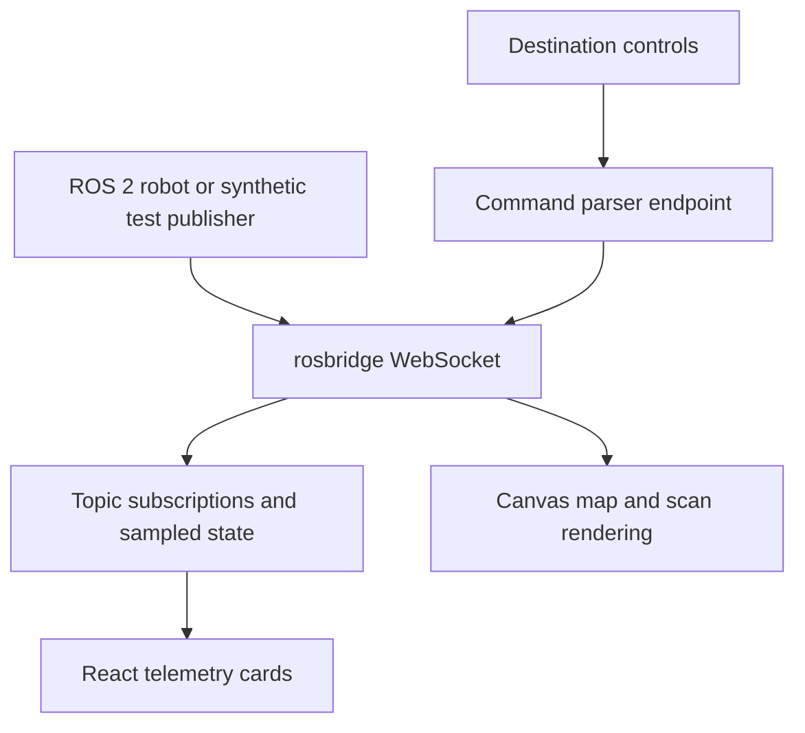

# ATLAS Console

A real-time web dashboard for an autonomous exploration robot. It connects to the
robot over **rosbridge** (WebSocket) and renders the live SLAM map, telemetry,
attitude, system health and event stream — from a laptop or a phone on the same
network.

> **Golden rule — honesty over polish.** Every number on screen comes from a real
> ROS topic. Hardware/features that aren't built yet (camera, ultrasonics) render
> an explicit *offline* state instead of inventing data. If a stream goes silent,
> its tile shows `—`, never a stale or fabricated value.

## Stack

- **React 19 + Vite** — UI.
- **roslib** — rosbridge client (WebSocket to `ws://<host>:9090`).
- **Canvas 2D** — map/scan/robot rendering (off React's state cycle, 60 fps).
- No CSS framework: the design system lives in `src/theme.css` (dark + light).

## Running

```bash
# 1. Terminal A — bring up rosbridge + a data source
source /opt/ros/jazzy/setup.bash
ros2 launch rosbridge_server rosbridge_websocket_launch.xml   # port 9090
python3 tools/fake_publisher.py        # dev stand-in for the robot / a rosbag

# 2. Terminal B — the dashboard
npm install
npm run dev                            # http://localhost:5173
```

On a phone, open `http://<laptop-ip>:5173` — the rosbridge host is derived from the
page URL (override with `?host=<ip>`), so "localhost" on the phone never points at
the phone itself.

`tools/fake_publisher.py` publishes correctly-shaped `/map`, `/scan`, `/odom`,
`/imu/data`, `/robot_pose` and `/sys_stats` so the UI can be built and verified
before the real rosbag is available. It is **not** a substitute for verifying
against the real robot.

## Architecture

```
src/
  App.jsx              composition only — owns hooks, distributes to tiles
  theme.css            design system (CSS vars, dark/light, all tile styles)
  ros/
    useRos.js          rosbridge singleton + auto-reconnect (useSyncExternalStore)
    topics.js          single source of truth for every topic name/type + status
    useRobotData.js    /odom /imu /sys_stats -> velocity, distance, yaw, cpu (5 Hz sampled)
    useRosHealth.js    /rosapi/nodes -> live node count + measured link latency
  hooks/
    useTheme.js        dark/light, persisted
    useMissionClock.js T+ since link
    useEventLog.js     events derived from REAL state transitions
  lib/geometry.js      shared quaternion->yaw, formatters
  components/
    Header, MapCard, MapCanvas, CameraCard, TelemetryCard, StripCard,
    strip/{Attitude,Ultrasonic,EventStream,SystemHealth,Waypoints}Seg
```

**Data discipline (so a 20 Hz robot doesn't cause 20 Hz React re-renders):** each
topic is subscribed exactly once. `MapCanvas` owns `/map`, `/scan`, `/robot_pose`
and drives the canvas imperatively, reporting derived stats (coverage, frontiers,
scan Hz, pose) upward on a throttle. `useRobotData` owns the rest and samples one
React snapshot at 5 Hz.

## Topic status (`src/ros/topics.js`)

| status  | meaning                                         | tiles |
|---------|-------------------------------------------------|-------|
| `live`  | published now (real robot / rosbag)             | map, scan, odom, imu |
| `node`  | needs one of our helper nodes running           | robot_pose, sys_stats |
| `later` | hardware/feature not built — show offline state | camera, ultrasonics |

## Verifying

`npm run lint && npm run build` must be clean. UI changes are verified in a real
browser (headless Chrome via puppeteer) against `fake_publisher` — canvas pixels
and tile text are asserted, not just "it compiled".

## Portfolio and contribution overview



## Demo and verification

The existing Running section provides the development setup, including the clearly labeled synthetic topic publisher. Use `npm ci`, then `npm run lint` and `npm run build` for local verification. View the dashboard using `npm run dev`. The README documents the intended 60 fps rendering architecture and 5 Hz state sampling; these are design targets/cadences, not performance measurements collected during this update. No synthetic-publisher screenshot is represented as a real robot capture.

## Team contribution

Yash Raj's documented contributions include the [dashboard import and destination tile](https://github.com/thevinayak26/Atlas_Dashboard/commit/c8e02f76ffb5411bc93a70b4e8f4178cbbc0f68e), [camera topic and 3D map UI](https://github.com/thevinayak26/Atlas_Dashboard/commit/19e1a6bc15fc43dc260d9db5cb31cfe2f64de40f), and [voice/text parsing and ROS publish fix](https://github.com/thevinayak26/Atlas_Dashboard/commit/170f19560164b3bb6486e55e1e861e799dd180bf). The dashboard is a collaborative project; the overall implementation should not be attributed to one person.
